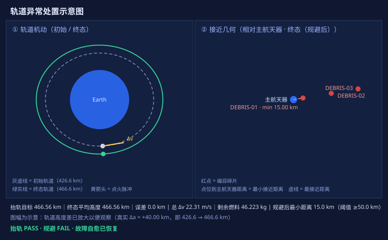

# orbit-anomaly-agent — Autonomous Spacecraft Orbital Anomaly Mitigation Agent

English | [简体中文](README.zh-CN.md)

<div align="center">

**Let an LLM actually *run* orbital-anomaly operations — not just talk about them.**

An autonomous agent that turns a plain-language task ("orbit is decaying, debris is approaching, 50 kg fuel left — handle it") into a full, verifiable closed loop: sense → diagnose → plan → execute → verify → self-heal.


**Team:** Stellar Chasers (逐星小队) · Undergraduate Group · No. U390 · Leader: Xu Haiming (徐海铭)

</div>

<p align="center">
  
</p>
<p align="center"><sub>Closed-loop result: +40 km raise → 466.558 km (Δv error 0.000%); 55% thruster fault auto-recovered; collision avoidance honestly reported as FAIL (min distance 15.0 km < 50 km threshold).</sub></p>

<details>
<summary><kbd>Contents</kbd></summary>

- [1. Project Overview](#1-project-overview)
  - [Background](#background)
  - [Core Functions](#core-functions)
  - [Innovation Highlights](#innovation-highlights)
- [2. Demo Video](#2-demo-video)
- [3. Architecture](#3-architecture)
  - [System Architecture](#system-architecture)
  - [Core Modules](#core-modules-11-mcp-tools)
  - [Implementation](#implementation)
- [4. Integration Standards](#4-integration-standards)
  - [Interface Specification (MCP over stdio)](#interface-specification-mcp-over-stdio)
  - [Technical Standards](#technical-standards)
  - [Integration Steps (mount the MCP server on AGH)](#integration-steps-mount-the-mcp-server-on-agh)
- [5. Reproduce Locally](#5-reproduce-locally)
- [6. Submission Documents](#6-submission-documents)
- [License & Third-party](#license--third-party)

</details>

---

## 1. Project Overview

### Background

Low-Earth-orbit (LEO) spacecraft — e.g. the ISS, at roughly 400 km altitude — face two persistent threats: (1) **orbital decay** caused by atmospheric drag, which slowly lowers the orbit and raises re-entry risk; and (2) **conjunction risk** from space debris (defunct satellites, upper stages, fragmentation fragments). These anomalies often appear together: the orbit is both decaying and being approached by debris.

Traditional disposal relies on ground control: engineers analyze telemetry, plan a maneuver, uplink commands, then wait for execution feedback. The full "detect → analyze → plan → execute → confirm" chain carries **minutes-to-hours of latency** — too slow for an emergency collision-avoidance window. Moving anomaly mitigation to the agent side, as an autonomous closed loop, is a key direction in spacecraft operations.

### Core Functions

Given a natural-language task, the agent autonomously completes the full anomaly-mitigation loop:

- **Orbit state & propagation** — resolve position/velocity/mean altitude, and propagate forward with the two-body model.
- **Maneuver planning & execution** — plan and apply orbit-raise / collision-avoidance burns (nominal Δv and fuel).
- **Conjunction detection** — per-object minimum distance, Time of Closest Approach (TCA), and risk level.
- **Autonomous closed-loop & fault self-healing** — detect → diagnose → plan → execute → verify, and **re-plan on its own when something goes wrong**.
- **Quantitative verification** — Monte-Carlo robustness and fault self-healing scans.
- **Visualization** — orbit-change & conjunction-geometry diagrams.

### Innovation Highlights

1. **Real computation, no fabrication.** Every key number (propagation, Δv, fuel, miss distance) comes from deterministic solvers (SGP4, two-body, vis-viva, rocket equation, enumeration search). The model only *orchestrates*; it never *generates* the numbers. Cross-checked with the vis-viva formula and rocket equation: **Δv error 0.000%, fuel error 0.006%**.
2. **Autonomous closed loop + fault self-healing.** The "sense–diagnose–plan–execute–verify–recover" chain runs to completion on its own. When a ~55% thruster under-performance fault is injected, the agent detects the shortfall, re-plans, and adds a corrective burn, finally reaching the target altitude and marking `recovered=true` — a fundamental difference from a general chatbot that can only say "suggest another burn."
3. **Tool-based encapsulation.** Orbital mechanics is decomposed into **11 MCP tools** the model can call, avoiding model hallucination and making every decision traceable and verifiable.
4. **Boundary honesty.** When a metric misses its threshold, the agent reports **FAIL** truthfully (e.g. post-avoidance min distance 15.0 km < 50 km requirement) with the physical reason — no cosmetic padding.
5. **Reproducibility.** Fixed TLE snapshot + fixed epoch + fixed seed → `REPRODUCE_MANIFEST.json` marks `reproducible: true`; judges can reproduce with one command (`reproduce.py`).

---

## 2. Demo Video

> 🎬 **Demo video:** _to be published_ — **[TODO: insert video link here]** (YouTube / Bilibili / mirror).

The demo shows a single natural-language question triggering the full closed loop: tool-chain scrolling, the 55% thruster-fault self-healing segment, the Monte-Carlo result, and the generated orbit figure. See [`orbit-agent/output/运行证据.pdf`](orbit-agent/output) for the captured AGH execution records and tool-call traces.

---

## 3. Architecture

### System Architecture

```
Natural-language task (user)
        │
        ▼
AGH  (Agnes Harness — the "brain": Agnes model agnes-3.0-flash,
     called internally via an OpenAI-compatible API)
        │  MCP (stdio, long-lived subprocess)
        ▼
orbit-agent tool layer  (FastMCP server, 11 tools)   ← this project
        │
        ▼
Deterministic solvers  (SGP4 propagation / two-body dynamics /
     vis-viva / rocket equation / avoidance enumeration)
        │
        ▼
Structured numbers  (state, elements, Δv, fuel, min distance, TCA, PASS/FAIL)
        │
        ▼
Agnes reads results → decides next step → closes the loop
```

- **Hard platform requirement:** built on AGH, with the model restricted to Agnes (per competition rules).
- **Reproducibility anchor:** fixed ISS snapshot (`FIXED_ISS_TLE`, mean altitude **426.558 km**) + fixed epoch (`2026-10-10T12:00:00.000`) + fixed random seed. Other inputs (other satellites / live TLE / different target altitude) still recompute, but the default is pinned for reproducibility.

### Core Modules (11 MCP tools)

| Tool | Role |
|------|------|
| `get_tle(target)` | Fetch target TLE (Celestrak → public-mirror fallback; honest "builtin sample" tag if all fail) |
| `get_state(tle, epoch)` | TLE → TEME state (r/v) + orbital elements |
| `propagate(state, minutes)` | Two-body propagation for N minutes, returns new state |
| `plan_maneuver_tool(state, objective, params)` | Plan raise / collision-avoidance maneuver (with Δv) |
| `apply_maneuver_tool(state, maneuver)` | Apply impulse, return final state |
| `conjunction(objects, primary_state, …)` | Min distance, TCA, risk level (multi-object catalog) |
| `verify_tool(…)` | Compare target vs result; quantitative metrics + PASS/FAIL |
| `run_scenario_tool(scenario)` | **One-shot full closed loop**: `raise` / `collision` / `anomaly_response` |
| `visualize_tool(scenario)` | Run scenario, render orbit / conjunction-geometry SVG + metric summary |
| `analyze_tool(scenario)` | **Theory vs simulation**: independent re-compute via vis-viva / rocket equation, returns relative error |
| `simulate_tool(experiment, n)` | **Simulation**: Monte-Carlo robustness / strategy compare / fault self-healing scan → stats + charts |

`run_scenario_tool` scenarios:
- `raise` — orbit raise, target-altitude verification.
- `collision` — enumerated optimal avoidance impulse, min-distance verification.
- `anomaly_response` (core) — simultaneous "decay + collision" handling, with fault injection `inject_fault`:
  - `thruster_underperformance` → auto re-plan second burn to reach altitude (**self-healing**);
  - `fuel_exhausted` → graceful degradation, refuse execution;
  - `data_unavailable` → fall back to builtin sample, still completes.
  - Returns `decision_trace` (detect→diagnose→plan→execute→verify→replan) and `overall_passed`.

### Implementation

- **Tool layer:** pure-Python functions in `orbit-agent/tools/` wrapped by `tools/server.py` (FastMCP), exposing the 11 tools over MCP stdio.
- **Deterministic solvers:** `tle.py` (SGP4 + TLE parse), `kepler.py` (state⇄elements, universal-variable two-body propagation), `maneuver.py`, `conjunction.py`, `verify.py`, `mission.py` (scenario orchestration), `analysis.py` (theory-vs-sim check), `simulate.py` (Monte-Carlo), `viz.py` / `diagram.py` (SVG rendering, no plotting deps).
- **Closed-loop orchestration:** `mission.run_scenario` chains the tools into a full FDIR loop, including composite-anomaly autonomous handling and fault self-healing.
- **Reproducibility:** `reproduce.py` runs tests + figures + simulation and writes `output/REPRODUCE_MANIFEST.json` (key metrics + file SHA256).

---

## 4. Integration Standards

### Interface Specification (MCP over stdio)

- **Transport:** MCP (Model Context Protocol) over **stdio**, as a **long-lived subprocess** multiplexed by the harness (one server process, reused across calls).
- **Server entry:** `run_mcp.sh` (Linux/WSL) / `run_mcp.bat` (Windows) — path-independent, auto-locates the project root and `.venv`.
- **Tool contract:** each tool is a single-responsibility function with a JSON schema (typed inputs → structured JSON output). Naming: `<verb>_<object>_tool` where applicable (e.g. `plan_maneuver_tool`).
- **Security:** the harness forbids spawning arbitrary executables by default. The MCP server must be declared in the resource whitelist `AGNES_RESOURCE_MCP_POLICY` before mount (see below).

### Technical Standards

- **Model API:** Agnes `agnes-3.0-flash`, OpenAI-compatible (`base_url https://api.agnes-ai.cn/v1`), invoked internally by AGH.
- **Numerical standards:** SGP4 (orbital propagation), two-body dynamics (state propagation), vis-viva equation (Δv), Tsiolkovsky rocket equation (fuel), enumeration search (avoidance). Fixed inputs for reproducibility.
- **Verification standard:** `verify_tool` uses tolerances (±5 km / ≥10 km) to decide PASS/FAIL; `analyze_tool` reports relative error against analytic baselines.

### Integration Steps (mount the MCP server on AGH)

> The key step judges often miss is the **MCP executable whitelist + load**. `<ROOT>` = where you cloned/unzipped the project.

**Step 1 — prepare the orbit-agent environment**

```bash
cd <ROOT>
python -m venv .venv
.venv/Scripts/activate            # Windows; or source .venv/bin/activate (Linux/WSL)
pip install -r requirements.txt
chmod +x run_mcp.sh               # Linux/WSL only
```

**Step 2 — start AGH with the MCP whitelist (critical)**

```bash
cd agnes-harness
export AGNES_RESOURCE_MCP_POLICY='{"allowedExecutables":["<ROOT>/run_mcp.sh"]}'
node packages/cli/dist/local/agnes.mjs serve
```

Keep this terminal open; it prints a loopback URL (e.g. `http://127.0.0.1:4177/`). Open `http://localhost:4177/` in a browser.

**Step 3 — register orbit-agent as an AGH MCP tool**

```bash
cd agnes-harness
node packages/cli/dist/local/agnes.mjs mcp add orbit-anomaly-agent \
  --name "Orbit Anomaly Agent" --stdio <ROOT>/run_mcp.sh
node packages/cli/dist/local/agnes.mjs mcp get orbit-anomaly-agent   # copy the revision
node packages/cli/dist/local/agnes.mjs mcp trust orbit-anomaly-agent --expected-revision <REV>
node packages/cli/dist/local/agnes.mjs mcp enable orbit-anomaly-agent --expected-revision <REV>
node packages/cli/dist/local/agnes.mjs mcp tools orbit-anomaly-agent  # expect 11 tools
```

**Step 4 — run the first closed loop**

In AGH, give Agnes a task (English or Chinese):

```
An orbital anomaly is detected: use run_scenario_tool to plan and execute an orbit-raise,
raising the mean altitude by about 40 km, then use verify_tool to check insertion accuracy,
and report Δv and fuel consumption.
```

Expected: AGH calls `run_scenario_tool` → `verify_tool` → outputs **PASS**. For the full showcase, run `run_scenario_tool(scenario="anomaly_response", inject_fault="thruster_underperformance")` to trigger "55% fault → self-heal → honest avoidance FAIL".

---

## 5. Reproduce Locally

```bash
cd orbit-agent
python -m venv .venv && .venv/Scripts/activate
pip install -r requirements.txt
python tests/run_suite.py          # test suite
python reproduce.py                # tests + figures + simulation → output/REPRODUCE_MANIFEST.json
```

Fixed epoch + fixed ISS snapshot (`FIXED_ISS_TLE`), uniform **+40 km** raise (target = 426.558 + 40 = **466.558 km**), fully reproducible. Reference results: raise Δv analytic vs simulated relative error ≈ **0.000%**, fuel error < 0.1%; `anomaly_response` under 55% thrust fault → verify detects shortfall → **re-plan self-heal** (`recovered=true`); debris avoidance ≥50 km honestly **FAIL** (~15 km physical cap).

---

## 6. Submission Documents

The four competition submission PDFs are at the repository root:

- `项目说明.pdf` — Project description (name / track / summary / problem & goal)
- `技术信息.pdf` — Technical information (AGH role, Agnes model, data/code/software/sim/API/device interfaces)
- `成员声明与分工.pdf` — Member statement & division of labor
- `运行证据.pdf` — Runtime evidence (AGH execution records, tool-call chains, Agnes participation, key config & verification results)

Detailed evidence lives in `orbit-agent/output/` (`仿真实验报告.md`, `AGH闭环测试报告.md`, `validation_table.md`, `REPRODUCE_MANIFEST.json`, figures).

---

## License & Third-party

Built for the *2026 Jiangsu AI + Science & Engineering Innovation Practice Hackathon (University Group)*. Third-party: sgp4 (LGPL/MIT), astropy (BSD-3), numpy (BSD-3), FastMCP (MIT), Celestrak public TLE data, Agnes Harness (AGH), Agnes model.
